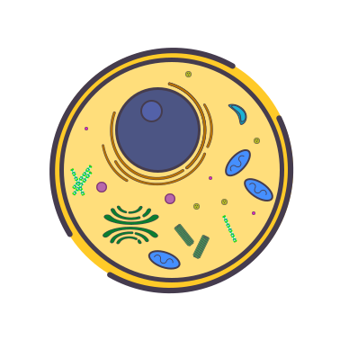
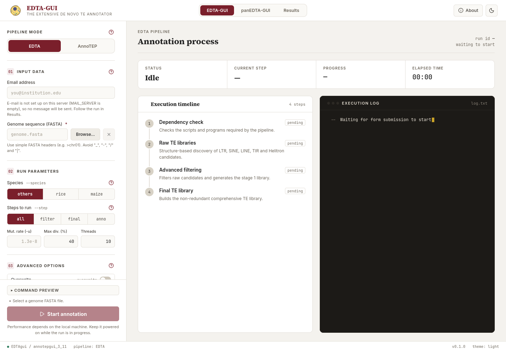
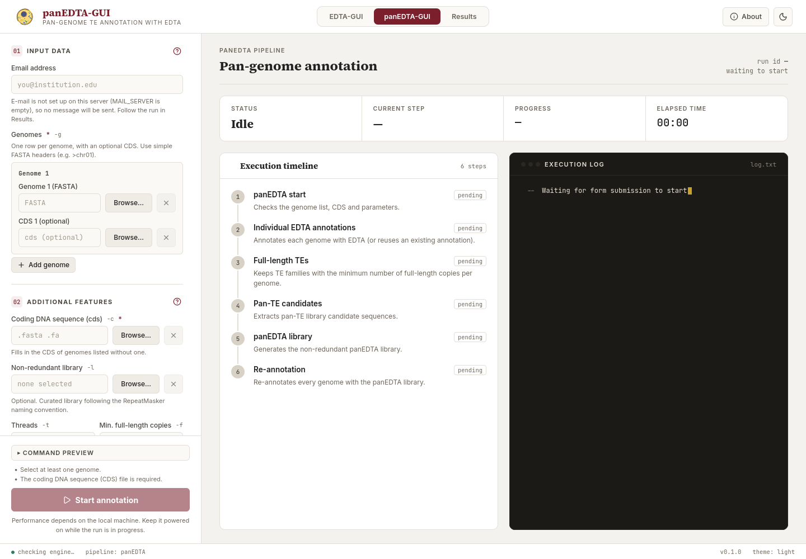
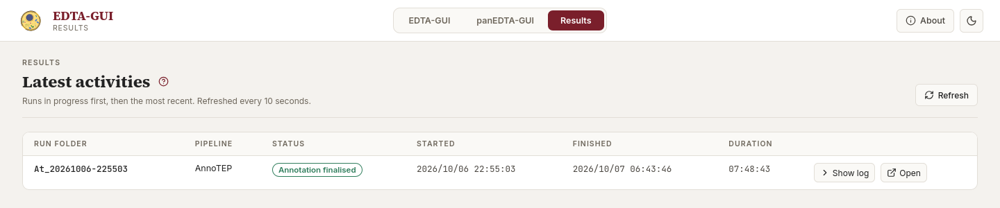
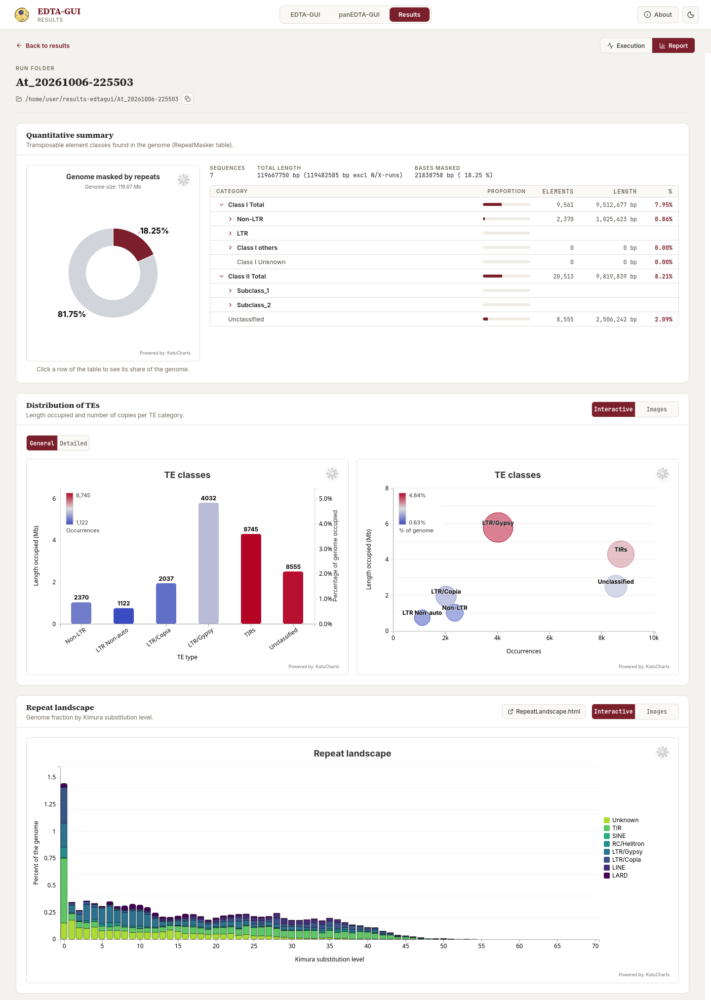

<div align="center">
    
    <h1>EDTA-GUI</h1>
    <p><b>The Extensive <i>de novo</i> TE Annotator, with a graphical interface</b></p>
</div>

<div align="center">

       

</div>

> [!NOTE]
> **Update (October 2026), EDTA-GUI 2.0:**
> * **New interface:** live timeline and log, a queue for several runs, interactive report and results page. Details in [What is new in version 2.0](#what-is-new-in-version-20);
> * **EDTA also makes charts and reports** (`REPORT/`), as AnnoTEP does, when Annotation is on;
> * **Run test analysis** button in the interface: fills in the form with the test data and starts the run;
> * **Automation by scripts:** `install.sh` sets up everything at once, and the `EDTA`, `AnnoTEP` and `panEDTA` commands run from any folder, without `conda activate`;
> * **New Docker image** `annotep/edta-gui:v2.0`, started with a single script (`start.sh`). If you already use it, run `bash start.sh update`.

## Table of Contents
  - [Introduction](#introduction)
  - [Quick start](#quick-start)
  - [What is new in version 2.0](#what-is-new-in-version-20)
  - [System requirements](#system-requirements)
  - [Installing EDTA-GUI](#installing-edta-gui)
    - [Option 1 – Docker (recommended)](#option-1--docker-recommended)
    - [Option 2 – Conda (from this repository)](#option-2--conda-from-this-repository)
  - [Exploring the EDTA-GUI interface](#exploring-the-edta-gui-interface)
    - [Annotation page (EDTA and AnnoTEP modes)](#annotation-page-edta-and-annotep-modes)
    - [panEDTA-GUI page](#panedta-gui-page)
    - [Results and Report](#results-and-report)
  - [E-mail notifications (optional)](#e-mail-notifications-optional)
  - [Testing](#testing)
    - [Testing the AnnoTEP mode](#testing-the-annotep-mode)
  - [Outputs](#outputs)
  - [Command line (CLI)](#command-line-cli)
  - [Docker: more options](#docker-more-options)
  - [Singularity / Apptainer](#singularity--apptainer)
  - [Troubleshooting](#troubleshooting)
  - [Citations](#citations)

## Introduction
This package was developed as an extension of the [EDTA pipeline](https://github.com/oushujun/EDTA), with the aim of providing a graphical interface for users. The purpose of EDTA-GUI is to make the use of EDTA more accessible, meeting the needs of researchers at different levels of experience – from beginners to experts – and facilitating the analysis and annotation of transposable elements in genomes. EDTA-GUI also features AnnoTEP mode, an extension of EDTA modified to annotate plant genomes comprehensively.

The interface runs **on your own computer** and is opened in the web browser. All processing happens locally; the internet is only needed for the installation and for the optional e-mail notifications.

The same pipelines can also be run from the **command line** (`AnnoTEP`, `EDTA` and `panEDTA`), for users who prefer scripts: see the [Quick start](#quick-start).

📎 Return to [Table of contents](#table-of-contents)

## Quick start
Go to: [Graphical interface](#exploring-the-edta-gui-interface) · [Command line (AnnoTEP / EDTA)](#command-line-cli) · [Docker](#option-1--docker-recommended) · [Full installation](#installing-edta-gui)

**Install once** (conda, no `sudo`; it installs the interface and the command line):
```sh
git clone https://github.com/Marcos-Fernando/EDTA-GUI.git ~/EDTA-GUI
bash ~/EDTA-GUI/install.sh
```
Prefer Docker? Only `start.sh` is needed: see [Option 1 – Docker](#option-1--docker-recommended).

**Graphical interface:**
```sh
EDTA-GUI        # opens http://localhost:8000
```
To stop it, press **Ctrl+C** in the same terminal. An annotation already running keeps going in the background; start `EDTA-GUI` again to follow it, and its status is updated when it ends. With Docker, use `bash start.sh` and `bash start.sh stop` (stopping the container also stops a running annotation, so `start.sh` asks first).

**Command line** (AnnoTEP, for plant genomes). Run it in the folder of your genome; the results and the charts (`REPORT/`) are written there:
```sh
AnnoTEP --genome genome.fa --species others --step all --sensitive 1 --anno 1 --threads 10
```
`EDTA` and `panEDTA` work the same way. All options: `AnnoTEP --help`, or the [interface field ↔ option table](#command-line-cli).

> [!IMPORTANT]
> Please use simple FASTA headers! For example: `>chr01`, `>scf001`, `>ctg001`.
>
> NEVER use characters like "_", "-", "/" or "|" in the headers (for example `>chr_001`, `>scf-001`, `>ctg|001`): the pipeline may crash. File names cannot start with "-".

📎 Return to [Table of contents](#table-of-contents)

## What is new in version 2.0
* **New interface** (React + FastAPI) replacing the Flask version: a live execution timeline and log, a queue for several runs, and a button to cancel a run.
* **Interactive report** for AnnoTEP runs and EDTA runs with the genome-wide annotation: genome masked by repeats (donut chart), TE distribution, repeat landscape, density by chromosome and the LTR phylogenetic tree, all exportable.
* **One-command start with Docker** (`start.sh`): the results are saved in `~/results-edtagui`, owned by you.
* **One-command setup with conda** (`install.sh`): no `conda activate`, no `sudo` and no manual RepeatMasker edits.
* **Command line**: type `EDTA`, `AnnoTEP` or `panEDTA` in any folder.
* **EDTA v2.3.3** in the EDTA mode, with the **MAKER mask** option and the optional **Run name** for the results folder.
* **Run test analysis** button: one click to check the installation with the test data.
* **About** button with the user guide inside the interface.

Version 2.0 keeps the folder format of version 1.x (`<genome>_<date>-<time>/` with `log.txt` and `status.txt`), so old runs can be opened in the new interface.

📎 Return to [Table of contents](#table-of-contents)

## System requirements
> [!IMPORTANT]
> 💾 <b>Software</b>
> - 🖥️ Linux 64-bit (tested on Ubuntu 20.04, 22.04 and 24.04)
> - 🐳 [Docker](https://docs.docker.com/engine/install/) with the `docker compose` plugin (version 2.24 or newer), **or** 📦 [Miniconda3](https://docs.conda.io/projects/miniconda/en/latest/)
>
> 💻 <b>Hardware</b> <br>
> To try the tool: 16 GB of RAM and about 40 GB of free disk (the Docker image takes about 21 GB). <br>
> Minimum requirements for genomes up to <b>1 GB</b>:
> * <b>Threads:</b> 20
> * <b>RAM:</b> 50 GB
> * <b>Storage:</b> 1 TB
>

📎 Return to [Table of contents](#table-of-contents)

## Installing EDTA-GUI
Choose **one** of the two options. Docker is the simplest one: nothing is installed on your system besides Docker itself.

### Option 1 – Docker (recommended)
You only need the `start.sh` file. It downloads the ready image `annotep/edta-gui:v2.0` from Docker Hub and opens the interface.

**Step 1.** Allow your user to run Docker without `sudo` (only once; then log out and log in again):
```sh
sudo usermod -aG docker $USER
```

**Step 2.** Download the image from Docker Hub (about 9 GB, only once):
```sh
docker pull annotep/edta-gui:v2.0
```
This step is optional: `start.sh` downloads the image by itself when it is missing. Doing it first lets you follow the download and check that Docker works.

**Step 3.** Download `start.sh` into a folder of your choice and run it:
```sh
mkdir -p ~/edta-gui && cd ~/edta-gui
wget https://raw.githubusercontent.com/Marcos-Fernando/EDTA-GUI/main/gui/start.sh
bash start.sh
```
The browser opens at http://localhost:8000. If it does not open, type this address in your browser.

The image already contains everything: the pipelines, the conda environments and the compiled interface. You do not need to install conda, Python or Node.js.

> [!TIP]
> If you cloned this repository, run `gui/start.sh` instead: it works the same way and can also build the image on your computer (`gui/start.sh build`, about 1 hour).

| Command | What it does |
|---|---|
| `bash start.sh` | Starts the interface |
| `bash start.sh stop` | Stops it. If an annotation is running, it asks first, because stopping interrupts it |
| `bash start.sh update` | Downloads a new version of the image and starts it |
| `bash start.sh logs` | Shows the server messages (useful when reporting an error). Leave with Ctrl+C |

| Variable | Default | Use |
|---|---|---|
| `EDTA_GUI_RESULTS` | `~/results-edtagui` | Folder where the results are saved |
| `EDTA_GUI_PORT` | `8000` | Port of the interface (`EDTA_GUI_PORT=8080 bash start.sh` → http://localhost:8080) |
| `EDTA_GUI_PIDS_LIMIT` | `300000` | Process limit of the container. Use threads × 10 000 when running with more than 30 threads |

The interface only accepts connections from your own computer: other machines on the network cannot open it.

📎 Return to [Table of contents](#table-of-contents)

### Option 2 – Conda (from this repository)
**Step 1.** Install [Miniconda3](https://docs.conda.io/projects/miniconda/en/latest/), if you do not have it:
```sh
bash Miniconda3-latest-Linux-x86_64.sh
```

**Step 2.** Download the repository and run the installer (from any folder):
```sh
git clone https://github.com/Marcos-Fernando/EDTA-GUI.git $HOME/EDTA-GUI
bash $HOME/EDTA-GUI/install.sh
```
The installer does everything, without `sudo`, and can be run again safely:
1. creates the conda environments `EDTAgui` (EDTA and panEDTA) and `annotepgui_3_11` (AnnoTEP and the interface). Existing environments are kept. This step can take a long time;
2. makes RepeatMasker accept sequence names up to 80 characters in both environments (`maxIDLength` 50 → 80). The manual edit of earlier versions is no longer needed;
3. builds the web interface (once, needs internet). Node.js and npm are only used for this step, and they come inside the `annotepgui_3_11` environment: you do not need to install them;
4. installs the `EDTA-GUI`, `EDTA`, `AnnoTEP` and `panEDTA` commands for your user (links in `~/.local/bin`).

**Step 3.** Open a **new** terminal and start the interface, from any folder:
```sh
EDTA-GUI
```
The browser opens at http://localhost:8000. Stop the interface with Ctrl+C.

| Command | What it does |
|---|---|
| `EDTA-GUI` | Starts the interface |
| `EDTA-GUI --build` | Builds the interface again, after `git pull` (uses the Node.js of the `annotepgui_3_11` environment) |
| `EDTA_GUI_PORT=8080 EDTA-GUI` | Uses another port |

* Results are saved in `EDTA-GUI/gui/backend/results` (another folder: `RESULTS_DIR=/path/to/folder EDTA-GUI`).
* To remove the commands: `bash $HOME/EDTA-GUI/cli/install.sh --uninstall`.

> [!NOTE]
> Version 1.x asked you to run `conda activate`, `sudo cp AnnoTEP/Scripts/break_fasta.pl /usr/local/bin`, edit RepeatMasker by hand and create a `.flaskenv` file. None of this is needed anymore. The old `AnnoTEPgui` environment is not used by version 2.0.

📎 Return to [Table of contents](#table-of-contents)

## Exploring the EDTA-GUI interface
The interface implements, as closely as possible, all the functionalities available in the traditional EDTA pipeline, in a more accessible way. It has three pages, selected at the top: **EDTA-GUI** (annotation of one genome), **panEDTA-GUI** (several genomes) and **Results**. The **About** button opens the user guide.

Every field has a help icon (?) with its description, and the **Command preview** at the bottom of the form shows the exact command that will be run.

### Annotation page (EDTA and AnnoTEP modes)
<div align="center">
    
</div>

On the left, the form; on the right, the progress of the run: status, current step, elapsed time, the timeline of the pipeline steps and the live log.

* **Pipeline mode:**
  * **EDTA:** annotation of transposable elements in eukaryotic genomes. Performs <i>de novo</i> detection and general classification of different TE classes. This is the default option for genomes of any eukaryotic organism.
  * **AnnoTEP:** specialised annotation of transposable elements in plant genomes. A version of EDTA adapted for high accuracy in identifying all classes, including autonomous and non-autonomous elements, as well as LTR lineages. Produces charts, detailed reports and phylogenetic trees. In this mode, Sensitivity and Annotation are always enabled.

**Input data**
* **Email address:** optional. Used to send notifications about the status of the analysis (see [E-mail notifications](#e-mail-notifications-optional)). The annotation runs locally, so keep the computer on during the process.
* **Genome sequence (FASTA):** the complete genomic sequence. Use the "Browse..." button to select the file (up to 10 GB).

The other sections of the form (**Run parameters**, **Advanced options** and **Additional files**) are explained inside the interface:
* the **(?)** icon next to each section and field shows what the option does, its accepted values and its default;
* the **About** button (top right) opens the complete user guide, with tables of all the options;
* the **Command preview**, at the bottom of the form, shows the exact command that will be run.

📎 Return to [Table of contents](#table-of-contents)

### panEDTA-GUI page
<div align="center">
    
</div>

panEDTA annotates several genomes in sequence and then combines them into a pan-genome library. Existing EDTA annotations of the genomes (EDTA run with `--anno 1`) are recognised and reused.

📎 Return to [Table of contents](#table-of-contents)

### Results and Report
<div align="center">
    
</div>

The **Results** page lists all runs (the ones in progress first), refreshed every 10 seconds: run folder, pipeline, status, start and end times and duration. **Show log** shows the last lines of the log, and **Open** opens the page of the run, with:
* **Execution:** the timeline of the steps, the log and, while the run is in progress, a button to cancel it. The run folder on your computer is shown at the top, with a button to copy it;
* **Report** (AnnoTEP runs): the interactive report.

<div align="center">
    
</div>

The report of the complete *A. thaliana* genome, above, shows the genome masked by repeats (click a row of the table to see its share of the genome), the TE distribution, the repeat landscape and the density by chromosome, followed by the LTR age charts and the LTR phylogenetic tree. Each chart can be exported, and the original images of the pipeline are available in the "Images" tab.

> [!NOTE]
> **Where are my results?** Every file of a run is saved **on your computer**, in its run folder (see [Outputs](#outputs)); the page of the run shows this folder, with a button to copy its path. Nothing is sent to a server. The interface is a way to browse these files and to save them in other forms:
> * **Charts:** the menu of each chart saves it as PNG, JPEG, SVG or PDF, or saves its data as CSV or XLS;
> * **Images:** the original PNG and PDF charts of the pipeline (`REPORT/`) can be opened and downloaded;
> * **Files:** the main outputs (TE annotation in GFF3, TE library, intact TEs, masked genomes, annotation summary, LAI report and the `REPORT/` tables) can be downloaded directly;
> * **Log:** the complete log of the run is shown in **Execution**.

A run is **completed** when its `status.txt` contains `Annotation finalised`, and **failed** when it contains `Error in the annotation step`. Runs made with version 1.x use the same format: copy their folders into the results folder and they appear in the list.

📎 Return to [Table of contents](#table-of-contents)

## E-mail notifications (optional)
Without configuration, no e-mail is sent, and the e-mail field says so. The notices on the page itself (start and end of the run) always work.

When configured, EDTA-GUI sends an e-mail when the annotation starts and another when it ends (successfully or with an error), with the log attached.

* **Docker:** copy `gui/mail.env.example` to `mail.env`, next to `start.sh`, fill it in, and run `bash start.sh stop` and `bash start.sh`.
* **Conda:** copy `gui/backend/.env.example` to `gui/backend/.env`, fill in the `MAIL_*` lines, and start `EDTA-GUI` again.

```sh
MAIL_SERVER=smtp.gmail.com
MAIL_PORT=587
MAIL_USE_TLS=True
MAIL_USE_SSL=False
MAIL_USERNAME=your.name@gmail.com
MAIL_PASSWORD=your_app_password
MAIL_DEFAULT_SENDER=your.name@gmail.com
```

> [!TIP]
> * Gmail: server `smtp.gmail.com`, port 587 (TLS) or 465 (SSL). Use an <b>app password</b> (it needs 2-Step Verification): https://myaccount.google.com/apppasswords
> * Outlook: server `smtp.office365.com`, port 587 (TLS).

> [!WARNING]
> * Avoid your primary e-mail account: use one dedicated to the application.
> * <b>Never share `mail.env` or `.env`</b>, nor publish them: they contain a password. Both are ignored by Git and are not copied into the Docker image.

📎 Return to [Table of contents](#table-of-contents)

## Testing
Test EDTA-GUI with the 1.2-Mb toy genome of the `test/` folder, which takes a few minutes. If the test finishes without errors (warnings are OK), EDTA-GUI is correctly installed. If the test is OK but your data fail, check your files for formatting or naming mistakes (see the FASTA headers note above).

**One click:** the **Run test analysis** button, at the top of the EDTA-GUI and panEDTA-GUI pages, fills in the form with the test data and starts the run after a confirmation (the e-mail and the number of threads are kept):

| Page | Test data | Time with 10 threads |
|---|---|---|
| EDTA-GUI, EDTA mode | `test/TAIR10_chr1.fa`, Sensitivity and Annotation on (charts included) | about 1 hour |
| EDTA-GUI, AnnoTEP mode | `test/TAIR10_chr1.fa` | about 1h20 |
| panEDTA-GUI | `test/Col.test.fa` (with `test/genome.cds.fa`) and `test/Ler.test.fa`, CDS `test/genome.cds.fa`, library `database/athrep.updated.nonredun.fasta` | about 5 min |

In EDTA-GUI, the results folder is named `Test_genome_<date-time>`. The steps below test the EDTA mode by hand, with the faster toy genome:

**1.** Pipeline mode: **EDTA**.

**2.** Genome sequence: `test/genome.fa`.

**3.** Advanced options: enable Overwrite, Sensitivity, Annotation and MAKER mask (needed for the exclusion file).

**4.** Threads: the number of threads you wish to use.

**5.** Coding DNA sequence: `test/genome.cds.fa`.

**6.** Curated library: `database/rice7.0.0.liban`.

**7.** Exclusion of masked regions: `test/genome.exclude.bed`.

**8.** Click **Start annotation** and follow the run in the timeline.

### Testing the AnnoTEP mode
The toy genome is too small for the complete AnnoTEP mode, which ends with an error on it. To test AnnoTEP, use **chromosome 1 of *Arabidopsis thaliana*** (TAIR10, 30.4 Mb), included as `test/TAIR10_chr1.fa`. With 10 threads, it took about 1h20 and produced the complete report (charts, LTR ages and phylogenetic tree).

* **Interface:** Pipeline mode **AnnoTEP**, Genome sequence `test/TAIR10_chr1.fa`, and click **Start annotation** (Sensitivity and Annotation are already on in this mode).
* **Command line**, in a work folder (the results are written in the current folder):
  ```sh
  mkdir -p ~/edta-test && cd ~/edta-test
  cp ~/EDTA-GUI/test/TAIR10_chr1.fa .
  AnnoTEP --genome TAIR10_chr1.fa --species others --step all --sensitive 1 --anno 1 --threads 10
  ```

The commands of all the tests (EDTA, AnnoTEP and panEDTA, with conda, Docker or Singularity) are in [test/README.txt](test/README.txt).

📎 Return to [Table of contents](#table-of-contents)

## Outputs
Each run has its own folder in the results directory:
* Docker: `~/results-edtagui/` (or the folder set with `EDTA_GUI_RESULTS`);
* Conda: `EDTA-GUI/gui/backend/results/` (or `RESULTS_DIR`).

| Folder | Created by |
|---|---|
| `<genome>_<YYYYmmdd-HHMMSS>/` | EDTA and AnnoTEP modes (e.g. `At_20261006-225503`); in the interface, the optional **Run name** field replaces the genome name (e.g. `TAIR10_test_20261031-102519`) |
| `panGenome_<YYYYmmdd-HHMMSS>/` | panEDTA-GUI |

Inside each folder:
* the outputs of EDTA (identical to the original EDTA) or of AnnoTEP, plus the `REPORT/` folder (charts and reports, described in the next section) for AnnoTEP runs and EDTA runs with `--anno 1`;
* `log.txt`: everything the pipeline wrote (stdout and stderr);
* `status.txt`: created at the end, with `Annotation finalised` or `Error in the annotation step`;
* `run.json`: the options and the command of the run, used by the interface.

The page of each run shows its exact folder on your computer, with a button to copy it.

📎 Return to [Table of contents](#table-of-contents)

## Command line (CLI)
The same pipelines can be run without the interface. Type the mode, followed by the usual options of `EDTA.pl` or `panEDTA.sh`:

```sh
EDTA    --genome genome.fa --species others --step all --anno 1 --threads 10
AnnoTEP --genome genome.fa --species others --step all --sensitive 1 --anno 1 --threads 10
panEDTA -g genomes.list -c cds.fa -t 10
```

* The analysis runs in the **current folder**, and the results stay there.
* No `conda activate` is needed: each command uses its environment (`EDTAgui` for EDTA and panEDTA, `annotepgui_3_11` for AnnoTEP).
* The options are passed unchanged. Without options, each command shows the original help (`EDTA --help`, `AnnoTEP --help`, `panEDTA`).
* `EDTA` and `AnnoTEP` also generate the charts and reports in `REPORT/` at the end, when the run includes the genome-wide annotation (`--anno 1`). For EDTA, LTRs are classified down to superfamily (Copia, Gypsy), so the charts show no lineages.

**Interface fields → command-line options** (help of each option: `EDTA --help` or `AnnoTEP --help`):

| Interface field | CLI option | Values | CLI default | Interface |
|---|---|---|---|---|
| Genome sequence | `--genome` | FASTA file | required | required |
| Species | `--species` | `others`, `rice`, `maize` | `others` | `others` |
| Steps to run | `--step` | `all`, `filter`, `final`, `anno` | `all` | `all` |
| Mut. rate (-u) | `--u` | number | `1.3e-8` | `1.3e-8` |
| Max div. (%) | `--maxdiv` | 0–100 | `40` | `40` |
| Threads | `--threads` or `-t` | integer | **`4`** | **`10` (minimum)** |
| Overwrite | `--overwrite` | `0` / `1` | `0` | off |
| Sensitivity | `--sensitive` | `0` / `1` | `0` | off; **always `1` in AnnoTEP** |
| Annotation | `--anno` | `0` / `1` | `0` | off; **always `1` in AnnoTEP** |
| Evaluate | `--evaluate` | `0` / `1` (needs `--anno 1`) | `1` (EDTA), **`0` (AnnoTEP)** | off |
| MAKER mask (EDTA) | `--maker` | `0` / `1` (needs `--anno 1`) | `0` | off |
| Force | `--force` | `0` / `1` | `0` | off |
| TIR filter (AnnoTEP) | `--TIR_filter` | `0` / `1` | `0` | off |
| Annot. type (AnnoTEP) | `--ANNOT_TYPE` | `0` / `1` | `0` | off |
| Run LAI (AnnoTEP) | `--run_LAI` | `0` / `1` | `1` | on |
| Coding DNA sequence | `--cds` | FASTA file | – | optional |
| Curated library | `--curatedlib` | FASTA file | – | optional |
| Exclusion of masked regions | `--exclude` | BED file (needs `--anno 1`; in EDTA, also `--maker 1`) | – | optional |
| RepeatModeler library | `--rmlib` | classified FASTA (skips RepeatModeler) | – | optional |
| RepeatMasker library | `--rmout` | RepeatMasker `.out` (needs `--anno 1`) | – | optional |

> [!IMPORTANT]
> Without options, the command line uses the defaults of `EDTA.pl`, which are **not** the ones of the interface (for example, 4 threads and no genome-wide annotation). The same AnnoTEP run as the interface defaults is:
> ```sh
> AnnoTEP --genome genome.fa --species others --step all --sensitive 1 --threads 10 --anno 1 --evaluate 0 --run_LAI 1
> ```
> In the interface, the **Command preview** shows the exact command of each run.

panEDTA: `-g` genome list (genome and, optionally, CDS per line), `-c` CDS file (required in the interface), `-l` curated library, `-t` threads (default 10), `-f` minimum full-length copies (default 3), `-o 1` to overwrite (always sent by the interface) and `-a 0` to build only the library.

| Where | How |
|---|---|
| Conda installation | After `install.sh`, the commands work in any folder |
| Docker | `docker run --rm -u $(id -u):$(id -g) --pids-limit 300000 --memory-swap -1 -v "$PWD":/data -w /data annotep/edta-gui:v2.0 AnnoTEP --genome genome.fa ...` |
| Singularity | `singularity exec edta-gui_v2.0.sif AnnoTEP --genome genome.fa ...` |

📎 Return to [Table of contents](#table-of-contents)

## Docker: more options
`start.sh` is the easiest way, but the image can also be used directly:

**Interface:**
```sh
mkdir -p ~/results-edtagui
docker run -d --name edta-gui --init -u $(id -u):$(id -g) \
  --pids-limit 300000 --memory-swap -1 \
  -p 127.0.0.1:8000:8000 \
  -v ~/results-edtagui:/usr/local/EDTA/gui/backend/results \
  -e DISPLAY_PATH_MAP=/usr/local/EDTA/gui/backend/results=$HOME/results-edtagui \
  annotep/edta-gui:v2.0
```
Then open http://localhost:8000. Stop it with `docker stop edta-gui && docker rm edta-gui`.

> [!TIP]
> ### Description:
> - `-u $(id -u):$(id -g)`: the results belong to your user, not to root.
> - `--pids-limit 300000 --memory-swap -1`: large genomes start many processes (about 10 000 per thread). Without these limits, Docker may stop the analysis. Use threads × 10 000.
> - `-p 127.0.0.1:8000:8000`: only your computer can open the interface (it has no login).
> - `-v ~/results-edtagui:/usr/local/EDTA/gui/backend/results`: the results folder on your machine. The path inside the container must not be changed.
> - `-e DISPLAY_PATH_MAP=...`: shows the run folders with their address on your machine.

**Command line:** see [Command line (CLI)](#command-line-cli).

> [!NOTE]
> The previous image, `annotep/edta-gui:v1.1` (Flask, port 5000, results in `/usr/local/EDTA/gui/results`), remains available on Docker Hub, but its commands do not apply to version 2.0.

📎 Return to [Table of contents](#table-of-contents)

## Singularity / Apptainer
Singularity (now Apptainer) can run the Docker image after converting it to a `.sif` file.

**Step 1. Convert the image** (choose one):
```sh
# directly from Docker Hub
singularity build edta-gui_v2.0.sif docker://annotep/edta-gui:v2.0

# from the image already in your local Docker
singularity build edta-gui_v2.0.sif docker-daemon://annotep/edta-gui:v2.0

# from a .tar file (to take the image to a computer without internet)
docker save annotep/edta-gui:v2.0 -o edtagui2.tar
singularity build edta-gui_v2.0.sif docker-archive://edtagui2.tar
```

**Step 2. Start the interface:**
```sh
mkdir -p $HOME/results-edtagui
singularity exec --cleanenv \
  --bind $HOME/results-edtagui:/usr/local/EDTA/gui/backend/results \
  --env DISPLAY_PATH_MAP=/usr/local/EDTA/gui/backend/results=$HOME/results-edtagui \
  --pwd /usr/local/EDTA/gui/backend \
  edta-gui_v2.0.sif \
  /usr/local/miniconda3/bin/conda run --no-capture-output -n annotepgui_3_11 \
  uvicorn app.main:app --host 127.0.0.1 --port 8000
```
Open http://127.0.0.1:8000 and stop it with Ctrl+C. On a remote server, open a tunnel from your computer (`ssh -L 8000:localhost:8000 user@server`) and use http://localhost:8000.

> [!TIP]
> ### Description:
> - `--bind ...`: the results folder on your machine (the rest of the image is read-only).
> - `--env DISPLAY_PATH_MAP=...`: shows the folders with their address on your machine.
> - `--host 127.0.0.1`: Singularity does not isolate the network; this keeps other machines out.
> - There is no `--pids-limit` in Singularity: for large genomes, run `ulimit -u 300000` first (threads × 10 000).

📎 Return to [Table of contents](#table-of-contents)

## Troubleshooting
| Problem | What to do |
|---|---|
| "Docker is not running, or your user cannot use it" | Start Docker, or run `sudo usermod -aG docker $USER` and log in again. |
| "EDTA-GUI did not answer" | Run `bash start.sh logs` and look at the last error message. |
| The analysis of a large genome stops in the middle (Docker) | Raise the process limit: `EDTA_GUI_PIDS_LIMIT=<threads × 10000> bash start.sh`. |
| RepeatMasker error about a long sequence identifier (`max id length = 50`) | The Docker image and `install.sh` already accept names up to 80 characters. For longer names, shorten the FASTA headers (e.g. `>chr01`). |
| The browser does not show notifications | Open the interface through `http://localhost:8000`, not through the machine IP. |
| The run stays many hours in the LINE step | Usually not an error: see below. |

**Long LINE step.** The LINE step runs RepeatModeler2, the slowest part of EDTA, and the log does not change while it runs. The complete *A. thaliana* genome took 5h35 in this step on a 6-core desktop; on a laptop, 12–20 hours is normal. RepeatModeler works in rounds over larger and larger samples of the genome, and each round takes about 3 times the previous one. To check the progress (Docker paths):
```sh
# rounds already done, with the time of their last change
ls -ld --time-style=+'%d/%m %H:%M' ~/results-edtagui/*/*.EDTA.raw/LINE/RM_*/round-*
# RepeatModeler log
tail -n 20 ~/results-edtagui/*/*.EDTA.raw/LINE/RM_*/rmod.log
# processes using CPU (rmblastn, RepeatScout or RepeatModeler = working)
docker exec edta-gui ps -eo pcpu,etime,cmd --sort=-pcpu | head
```
It is an error if the run shows **failed**, or if no pipeline process uses CPU for hours. To skip this step in a new run, provide a **RepeatModeler library**.

📎 Return to [Table of contents](#table-of-contents)

## Citations
Costa, M.F.S., Almeida, S.S.d., Monteiro, C.d. et al. EDTA-GUI: a plant-optimized graphical implementation of the EDTA pipeline enabling lineage-level classification and analysis. [BMC Genomics (2026)](https://doi.org/10.1186/s12864-026-12588-z).

* This work is an extension of the EDTA tool. Therefore, when using EDTA-GUI in publications or projects, please cite the following original articles:

Ou S., Su W., Liao Y., Chougule K., Agda J. R. A., Hellinga A. J., Lugo C. S. B., Elliott T. A., Ware D., Peterson T., Jiang N.✉, Hirsch C. N.✉ and Hufford M. B.✉ (2019). Benchmarking Transposable Element Annotation Methods for Creation of a Streamlined, Comprehensive Pipeline. [Genome Biol. 20(1): 275.](https://genomebiology.biomedcentral.com/articles/10.1186/s13059-019-1905-y)

Ou S., Scheben A., Collins T., Qiu Y., Seetharam A., Menard C., Manchanda N., Gent J., Schatz M., Anderson S., Hufford M.✉, Hirsch C.✉ (2024). Differences in activity and stability drive transposable element variation in tropical and temperate maize. [Genome Research](https://doi.org/10.1101/gr.278131.123)

📎 Return to [Table of contents](#table-of-contents)
